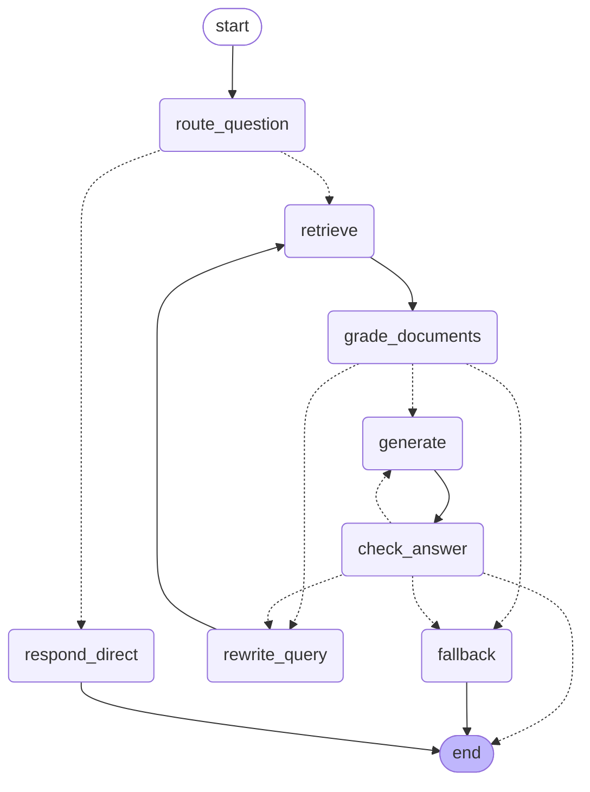

# Agentic RAG Copilot


Sistema **RAG agentico self-corrective** su documentazione tecnica di manutenzione,
costruito con **LangChain / LangGraph**, **FastAPI**, **Chroma** e LLM locali serviti da
**Ollama**. Nessun cloud, nessuna API key, nessun costo: tutto gira sulla macchina.

> **Stato:** Fase 2 completata. L'agente self-corrective (LangGraph) valuta i documenti
> recuperati, riformula la ricerca, controlla le proprie risposte ed è esposto via API
> FastAPI. Prossima: robustezza e observability (Fase 3).

## Perché questo progetto

Nasce per dimostrare le competenze centrali di un ruolo *Agentic AI / LLM Developer*:
RAG approfondito, orchestrazione di agenti con LangGraph, robustezza e osservabilità,
CI/CD con valutazione automatica della qualità.

L'approccio è volutamente incrementale: prima una **baseline RAG lineare** (Fase 1), poi
lo **strato agentico** costruito sopra (Fase 2). Così il "prima/dopo" è visibile e ogni
scelta progettuale può essere spiegata e difesa.

### Perché un RAG lineare non basta

Un RAG lineare fa sempre gli stessi passi: recupera i k chunk più simili e li passa
tutti all'LLM, anche quando non c'entrano. Non sa accorgersi di aver cercato male, né di
aver risposto male. Due esempi reali sul corpus di esempio:

- **Rumore nel contesto.** Per *"pump vibrating"* il chunk giusto (§9.3 *Excessive
  vibration*) arriva primo, ma gli altri 3 su 4 sono rumore (panoramica, specifiche,
  allineamento) che finisce comunque nel prompt.
- **Domanda in italiano.** Per *"la pompa perde dalla tenuta, cosa faccio?"* la
  similarità semantica in italiano non trova la §9.5 *Seal leakage*. Il RAG lineare
  risponde sul problema sbagliato (§9.1, adescamento) e cita una fonte che non esiste:

```
[LINEAR]  Non conosco il problema specifico della pompa che non tiene la tenuta.
          Tuttavia, posso suggerirti di controllare se la pompa è stata primata
          correttamente (9.1 Pump does not deliver liquid) ...  Fonte: manual.md

[AGENT]   According to Section 9.5 Seal leakage, possible causes of seal leakage
          include: centering clips left in place after installation, worn seal faces,
          dry running, solids in the pumped liquid ...
          path: route -> retrieve -> grade 0/4 -> rewrite -> retrieve -> grade 1/4
                -> generate -> check: not_useful -> rewrite -> retrieve -> grade 2/4
                -> generate -> check: not_grounded -> generate (stricter) -> check: useful
```

## Architettura

L'agente è un grafo in stile **CRAG / Self-RAG**: archi condizionali e cicli, non una
linea retta. Il diagramma è generato dal grafo compilato
(`get_agent().get_graph().draw_mermaid()`); le frecce tratteggiate sono gli archi
condizionali.



| Nodo | Ruolo dell'LLM | Cosa fa |
|---|---|---|
| `route_question` | giudice | Saluto/chiacchiera → `respond_direct`; qualunque richiesta di informazioni → `retrieve` |
| `retrieve` | — | Recupera i k chunk più simili alla query corrente |
| `grade_documents` | giudice | Valuta ogni chunk (sì/no) e tiene solo quelli rilevanti (passo *corrective* di CRAG) |
| `rewrite_query` | scrittore | Nessun chunk rilevante → riformula la query in inglese tecnico (e traduce le domande in italiano) |
| `generate` | scrittore | Risponde usando **solo** i chunk rilevanti; al secondo tentativo con un prompt più severo |
| `check_answer` | 2 giudici | Self-RAG: la risposta è fondata sui chunk? Risponde alla domanda? |
| `fallback` | — | Tentativi esauriti → "I don't know" fisso, senza improvvisare |

La differenza rispetto al RAG lineare sta tutta nelle frecce che **tornano indietro**:
l'agente valuta il proprio lavoro e si corregge. Ogni ciclo è limitato da un contatore
nello stato (`max_rewrites`, `max_generations`), quindi il grafo termina sempre.

Due scelte di design:

- **LLM come giudice con output strutturato.** I nodi giudice usano
  `with_structured_output`: il modello deve rispondere con un JSON conforme a uno schema
  Pydantic (`"yes"`/`"no"`), così il grafo ramifica su un valore affidabile invece di
  interpretare testo libero.
- **I giudici lavorano in inglese.** I chunk vengono valutati rispetto alla *query di
  ricerca* (in inglese), non alla domanda originale: il modello da 3B sbaglia soprattutto
  quando confronta testi in lingue diverse. Per una domanda in italiano il primo giro non
  trova nulla, la riscrittura fa da traduzione e il secondo giro valuta nella lingua dei
  manuali. I prompt dei giudici sono stati tarati su piccoli banchi di prova etichettati
  a mano (es. fondatezza: da 5/9 a 8/9 casi corretti, con 0 risposte inventate promosse).

### Limiti noti

L'agente è tarato per la **precisione**: preferisce dire "non lo so" piuttosto che
rispondere senza supporto. Il prezzo sono alcuni **falsi negativi** sulle domande che
richiedono di collegare punti diversi del manuale. Per esempio, a *"How often should I
check the coupling alignment?"* l'agente risponde "I don't know", mentre il RAG lineare dà
una risposta parziale (§8, "dopo ogni intervento sul giunto"). Inoltre la comprensione
dell'italiano dipende dal modello locale da 3B (es. "giunto" tradotto con *bearing*
invece di *coupling*). Misurare questi compromessi in modo sistematico è il compito della
Fase 4 (eval).

## Stack tecnologico

| Ambito | Strumento |
|---|---|
| Orchestrazione agente | LangGraph + LangChain |
| LLM (locale) | Ollama — `llama3.2:3b` |
| Embeddings (locale) | Ollama — `nomic-embed-text` |
| Vector store | Chroma (persistito su disco) |
| Backend API | FastAPI |
| Configurazione | pydantic-settings |
| Eval / Observability | ragas + Arize Phoenix *(previsti)* |
| CI | GitHub Actions *(prevista)* |

## Struttura del progetto

```
src/copilot/
├── config.py          # configurazione centralizzata (pydantic-settings, prefisso COPILOT_)
├── agent/
│   ├── state.py       # AgentState — la memoria di lavoro che scorre tra i nodi
│   ├── nodes.py       # i nodi: route, retrieve, grade, rewrite, generate, check, fallback
│   └── graph.py       # il grafo LangGraph (archi condizionali) + run_agent()
├── api/
│   ├── main.py        # l'app FastAPI (entry point per uvicorn)
│   ├── routes.py      # GET /health, POST /chat
│   └── schemas.py     # contratto request/response (Pydantic)
├── llm/
│   ├── provider.py    # get_llm()        — factory dell'LLM, model-agnostic
│   └── embeddings.py  # get_embeddings() — factory del modello di embedding
└── rag/
    ├── ingestion.py   # load_documents(), split_documents(), ingest()
    ├── vectorstore.py # get_vectorstore() — connessione a Chroma
    ├── retriever.py   # get_retriever()   — il vector store come Runnable
    └── chain.py       # get_rag_chain(), answer() — la baseline lineare (LCEL)

data/manuals/          # corpus sorgente (versionato)
data/chroma/           # vector DB generato (non versionato: si rigenera con scripts/ingest.py)
scripts/ingest.py      # comando per (ri)popolare il vector store
scripts/compare.py     # prima/dopo: RAG lineare vs agente, fianco a fianco
Test_Funzioni/         # uno script di test per funzione, in ordine bottom-up (01–16)
info/                  # documenti di design e note di studio
img/                   # immagini del progetto
```

Il criterio è la **separazione delle responsabilità**: `llm/` conosce solo i modelli,
`rag/` solo il recupero della conoscenza, `agent/` solo il controllo di flusso, `api/`
solo il protocollo HTTP, `config.py` è l'unico posto dove vivono i parametri. Ogni modulo
è testabile da solo. Nel passaggio dal RAG lineare all'agente, nello strato API è
cambiata una sola riga.

## Avvio rapido

**Prerequisiti:** [Ollama](https://ollama.com) attivo in locale, Python 3.11.

```bash
# 1. scarica i modelli locali (~2,3 GB in totale)
ollama pull llama3.2:3b
ollama pull nomic-embed-text

# 2. installa il progetto (editable, con le dipendenze di sviluppo)
pip install -e ".[dev]"

# 3. costruisci il vector store a partire da data/manuals/
python scripts/ingest.py

# 4. avvia l'API
uvicorn copilot.api.main:app --reload
```

Poi apri <http://localhost:8000/docs> per provare l'API dal browser, oppure:

```bash
curl -X POST localhost:8000/chat \
  -H "Content-Type: application/json" \
  -d '{"question": "What grease should I use for the bearings?"}'
```

```json
{
  "answer": "According to Section 5 of the manual, you should use a lithium-complex grease with NLGI grade 2 ...",
  "sources": ["centrifugal-pump-maintenance-manual.md"],
  "steps": [
    "route -> retrieve",
    "retrieve -> 4 chunks for 'What grease should I use for the bearings?'",
    "grade -> 2/4 relevant",
    "generate (attempt 1)",
    "check -> useful"
  ]
}
```

| Endpoint | Metodo | Descrizione |
|---|---|---|
| `/health` | GET | Liveness check → `{"status": "ok"}` |
| `/chat` | POST | `{"question": "..."}` → `answer` fondata sui manuali e citata, `sources` (i manuali usati) e `steps` (il percorso dell'agente nel grafo) |
| `/docs` | GET | Documentazione interattiva (Swagger), generata automaticamente |

Le domande vuote, mancanti o più lunghe di 2000 caratteri vengono rifiutate con `422`
prima di raggiungere l'LLM.

Per vedere il prima/dopo, RAG lineare e agente sulle stesse domande:

```bash
python scripts/compare.py                        # domande dimostrative
python scripts/compare.py "la pompa vibra molto"  # domande tue
```

La configurazione è opzionale: ogni parametro ha un default sensato (compresi i budget
di autocorrezione `COPILOT_MAX_REWRITES` e `COPILOT_MAX_GENERATIONS`). Per modificarli,
copia `.env.example` in `.env`.

> Il corpus e i prompt sono in **inglese** per una ragione tecnica: i test sugli
> embedding hanno mostrato una separazione semantica molto più netta in inglese che in
> italiano con `nomic-embed-text`, e un retrieval debole avrebbe compromesso tutto il
> resto della catena. Le domande in italiano sono supportate grazie alla riscrittura
> della query.

## Roadmap

| Fase | Focus | Stato |
|---|---|---|
| 1 | Baseline RAG lineare (ingestion, retrieval, chain LCEL, citazioni, API FastAPI) | ✅ completata |
| 2 | Agente self-corrective con LangGraph (route / grade / rewrite / generate / check) | ✅ completata |
| 3 | Guardrail, gestione errori, tracing con Phoenix | 🔜 prossima |
| 4 | Dataset di valutazione (ragas + trajectory eval) e CI/CD | prevista |
| 5 | Opzionali: tool verso sistemi esterni (CMMS), Docker/K8s, framework alternativi | futura |

## Documentazione

I documenti di progettazione si trovano in [`info/`](info/):

- [`info/PROGETTO.md`](info/PROGETTO.md) — visione, concetti RAG, architettura, struttura
- [`info/FASI.md`](info/FASI.md) — le cinque fasi nel dettaglio
- [`info/TEORIA/`](info/TEORIA/) — note di studio sugli interni di LangChain (Runnable, LCEL, `.invoke()`)
